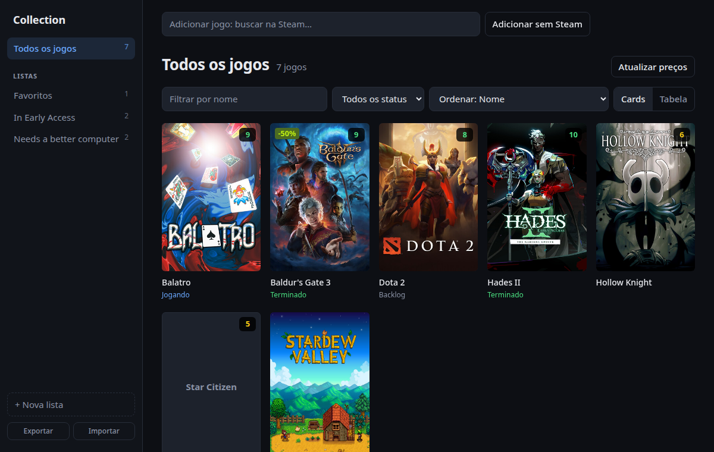

# Collection

App desktop para organizar sua coleção de jogos em listas, no estilo das coleções da Steam.



## O que faz

- Busca jogos na Steam enquanto você digita e salva capa e preço
- Listas (um jogo pode estar em várias), com sidebar e contagem
- Status (Backlog, Jogando, Terminado, Abandonado) e nota de 0 a 10
- Botão "O que jogar?" sorteia um jogo vinculado (Steam ou executável) e mostra num dialog, com "Ir à página" e "Reroll"
- Visualização em cards ou tabela, com filtros (que podem ser salvos com nome) e ordenação
- Atualiza preços da Steam uma vez por dia; em promoção mostra o preço original junto
- Alerta de promoção (preço-alvo ou desconto mínimo) com notificação
- Histórico de status com datas: começou, voltou ao backlog, retomou, terminou
- Vincula o jogo à Steam ou a um executável e abre direto do app
- Backup manual dos saves de cada jogo
- Tempo de jogo dos jogos abertos pelo executável ou pela Steam (Steam só no Windows)
- Página de estatísticas
- Atualização do app pelas releases do GitHub (botão em Configurações)
- Arrastar jogos para as listas da sidebar
- Anotações em markdown com live preview
- Backup da coleção em JSON (exportar e importar)

## Rodar

Requisitos: Node 24, Rust e os [pré-requisitos do Tauri](https://tauri.app/start/prerequisites/).

```sh
npm install
npm run tauri dev
```

## Outros comandos

```sh
npm test                         # testes do front
cargo test --manifest-path src-tauri/Cargo.toml  # testes do Rust
npm run tauri build              # gera o instalador
```

O build de release assina a atualização; ele precisa da chave privada no ambiente:
`export TAURI_SIGNING_PRIVATE_KEY="$(cat ~/.tauri/collection.key)"`.

Para publicar uma versão com instaladores, veja [RELEASE.md](RELEASE.md).

## Notas de processadores e placas de vídeo

O "Comparar com meu PC" dos requisitos usa `src/hardware.json`, gerado por `scripts/build-hardware.ts` a partir de:

- PassMark CPU Mark e G3D Mark, pelos datasets do Kaggle [alanjo/cpu-benchmarks](https://www.kaggle.com/datasets/alanjo/cpu-benchmarks) e [alanjo/gpu-benchmarks](https://www.kaggle.com/datasets/alanjo/gpu-benchmarks) (até 2022);
- [Blender Open Data](https://opendata.blender.org/) (CC0), para estimar os modelos mais novos.

O comando para gerar de novo está no topo do script.

## Onde ficam os dados

Banco SQLite `collection.db` em:

- Linux: `~/.config/com.gharantes.collection/`
- Windows: `%APPDATA%\com.gharantes.collection\`
- macOS: `~/Library/Application Support/com.gharantes.collection/`

Os backups de saves ficam em `saves/` dentro da pasta de dados do app (`~/.local/share/com.gharantes.collection/` no Linux).

## Stack

Tauri 2, React 19, TypeScript, Vite, SQLite (`tauri-plugin-sql`) e CodeMirror 6.
